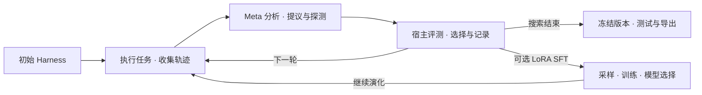

<div align="center">

<h1>RSI Base</h1>

<p><strong>递归自我改进的基础实验环境</strong></p>
<p>让 Meta Agent 基于真实运行证据改进 Task Agent 的 harness。</p>

<p>
  <a href="https://github.com/PLUTO-SCY/RSI_Base/actions/workflows/ci.yml"></a>
  
  
</p>

<p>
  <a href="#快速开始">快速开始</a> ·
  <a href="docs/getting-started.md">使用文档</a> ·
  <a href="docs/architecture.md">实现结构</a> ·
  <a href="docs/lora-sft.md">LoRA SFT</a> ·
  <a href="docs/lora-grpo.md">LoRA GRPO</a> ·
  <a href="docs/full-tuning.md">全参微调</a> ·
  <a href="CONTRIBUTING.md">开发约定</a>
</p>

</div>

---

## 工作方式

RSI Base 为 RSI 研究提供一套可复用的实验闭环。Meta 提出 harness 改动，宿主执行任务、评测并选择版本。SFT 与固定数学 harness 上的 verl GRPO 都可选择 **LoRA** 或 **全参微调**。



| 组件 | 当前实现 | 职责 |
| --- | --- | --- |
| **Meta Agent** | Claude Code + DeepSeek API | 查看源码、开发数据与完整轨迹，通过 MCP 探测并提交候选 |
| **Task Agent** | Qwen3-4B-Instruct-2507 + vLLM | 通过 OpenAI 兼容接口执行任务，也可接入已有推理服务 |
| **Harness** | 配置 + Python 检索函数 | 演化 prompt、检索算法、示例组织与单步／复核流程 |
| **训练后端** | Transformers + PEFT / verl | 导出 LoRA adapter 或完整模型，由 Task 服务加载评测 |
| **实验宿主** | Python 编排与评测 | 固定评分协议，管理预算、版本、断点恢复与冻结后测试 |

默认初始 harness 根据任务描述和标签，通过一次模型调用完成分类。harness 演化阶段固定 Task 权重。LoRA SFT 使用训练集轨迹做监督更新，LoRA GRPO 在固定数学 harness 上用在线采样和数值奖励更新权重。

## 快速开始

在 Linux 仓库根目录执行。需要 Git、`curl`、Node.js ≥18/npm；本地推理还需要 NVIDIA 驱动和支持 BF16 的 GPU。

### 1. 准备环境与资源

```sh
git clone https://github.com/PLUTO-SCY/RSI_Base.git
cd RSI_Base

# 安装项目内的 Python、GPU 推理、Claude Code 与隔离执行环境
sh scripts/harness.sh setup --gpu --claude --sandbox

# 隐藏输入 API key，再下载并校验数据与模型
sh scripts/harness.sh credentials
sh scripts/harness.sh data
sh scripts/harness.sh model
```

同机使用 SFT 和 verl GRPO 时，安装命令加上 `--train --rl`。全套安装及训练数据准备见 [环境与运行](docs/getting-started.md)。

### 2. 启动 Task 服务

```sh
RSI_GPU=0 RSI_TASK_PORT=18000 sh scripts/harness.sh serve
```

保持服务运行，后续命令在**另一个终端**执行。

### 3. 检查并开始演化

```sh
# 检查环境与服务；用两次 Task 请求验证连接和输出格式
sh scripts/harness.sh doctor --ready --local-gpu
sh scripts/harness.sh smoke

# 启动真实 Meta/Task 演化并查看进度
sh scripts/harness.sh run search
sh scripts/harness.sh inspect
```

默认使用 [`configs/default.json`](configs/default.json)，演化 **5 轮**，产物写入 `runs/demo/`。中断后使用相同命令恢复，已完成的请求会被复用。

> [!TIP]
> 已有 Task 推理服务时，可省略 GPU 环境安装与模型下载，修改配置中的 `task` 即可。环境均保存在项目内，安装脚本不修改系统 Python、shell profile 或全局 Claude 配置。

## LoRA SFT

在已有冻结 harness 和 Task 服务的基础上，接入模型更新：

```sh
sh scripts/harness.sh setup --train
sh scripts/harness.sh sft collect --source-run runs/demo
RSI_TRAIN_GPUS=1 sh scripts/harness.sh sft train
RSI_GPU=2 sh scripts/harness.sh serve-adapter
```

保持 adapter 服务运行，在另一个终端执行 `sh scripts/harness.sh sft evaluate`。开发集评测会交叉比较训练前后模型与初始／演化后 harness，并生成下一轮搜索配置。完整流程、恢复、多卡训练与冻结后测试见 [LoRA SFT 使用说明](docs/lora-sft.md)。

## LoRA GRPO

使用 verl 在线采样并优化固定数学 harness 下的 Task 模型。训练可从基础模型开始，也可读取同一基座上的已有 LoRA adapter。参见 [LoRA GRPO 使用说明](docs/lora-grpo.md)与 [verl 环境排查](docs/verl-troubleshooting.md)。

## 全参微调

SFT 与 GRPO 配置可设置 `"training_mode": "full"`。全参模型以 `model/` 导出，可用 `parent_checkpoint` 接入下一轮训练。配置和配对评测命令见 [全参 SFT 与全参 GRPO](docs/full-tuning.md)。

## 实验与复用

| 想做什么 | 入口 |
| --- | --- |
| 修改模型、轮数和预算 | [`configs/default.json`](configs/default.json) |
| 运行离线检查 | `sh scripts/harness.sh check` |
| 查看运行进度 | `sh scripts/harness.sh inspect runs/demo` |
| 多种子实验、冻结后测试与曲线导出 | [运行与恢复](docs/getting-started.md#4-执行与恢复) |
| 配置 4 卡并行、替换 API 或数据 | [环境与运行](docs/getting-started.md) |
| 扩展 harness 或接入其他任务 | [实现结构](docs/architecture.md) |

内置示例为 **Symptom2Disease · 22 类文本分类**，固定划分为 **200 条训练记忆 / 300 条开发样本 / 291 条测试样本**。脚本自动下载并校验；来源、去重规则与划分种子记录在[数据锁文件](requirements/data/s2d.json)中。

> [!NOTE]
> 示例采用公开合成数据，此划分曾用于开发，默认标记为历史回放。开展独立泛化评测时，请准备未参与开发的测试集。

## 仓库结构

```text
RSI_Base/
├── configs/               harness、LoRA SFT 与 GRPO 配置
├── src/rsi_base/           Agent、harness、搜索、评测与记录
├── scripts/               安装、数据准备、服务、运行与导出
├── requirements/          GPU、CLI、隔离工具及数据版本锁
├── tests/                 离线契约测试
├── docs/                  环境与运行说明、实现结构
└── uv.lock                核心与开发依赖锁
```

运行结果保存在 `runs/`。核心、Task 推理、SFT 和 GRPO 环境分别位于 `.venv/`、`.venv-task/`、`.venv-train/` 和 `.venvs/rl/`，缓存和模型位于 `.local/`。这些目录由 Git 忽略。环境入口见 [环境与运行](docs/getting-started.md#1-安装)。
