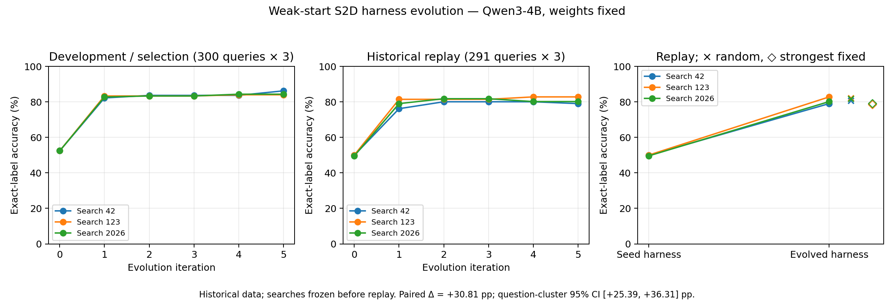
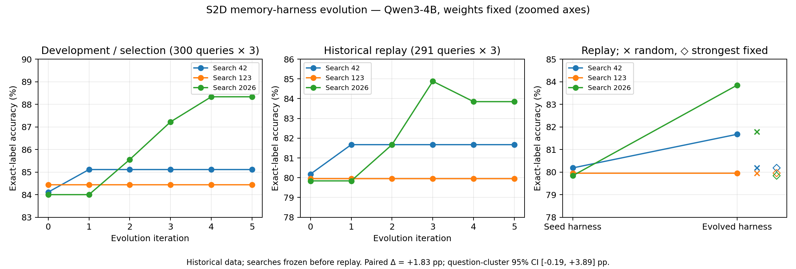

# RSI Base

从零实现、按阶段扩展的RSI实验框架，面向evaluator、效率和泛化研究。当前只做固定权重的harness evolution，LoRA后置。

**当前目标是搭建可复用的RSI基础设施。默认从简单、未经优化的harness开始，验证完整闭环并观察相对起点的改进。** 不要求先证明优化算法优于强固定或随机搜索。

当前演示任务为Symptom2Disease的22类文本分类，使用200条训练记忆、300题开发和291题历史回放。

默认配置[`configs/memory_s2d_agent.json`](configs/memory_s2d_agent.json)显式使用`initial_baseline="no_memory"`：普通分类提示、完整标签/输出合同、无检索示例、单次模型调用。Meta可以逐步增加检索、上下文组织、改写/复核或Python检索代码。已完成真实DeepSeek Meta + 本地Qwen3-4B Task实测，三个seed各五轮；模型权重固定。

**弱起点实测结果：开发平均52.44%→84.85%；291题历史回放平均49.87%→80.68%，三次均提高。**

| seed | 开发集起点→最终 | 历史回放起点→最终 |
| --- | ---: | ---: |
| 42 | 52.44%→86.22% | 49.94%→79.04% |
| 123 | 52.44%→84.00% | 50.06%→82.82% |
| 2026 | 52.44%→84.33% | 49.60%→80.18% |



已核验2700条实际起点记录均无检索、单次调用；冻结恢复新增调用0。两轮Meta输出超限已记录，保留父代后继续完成。74项离线检查通过，临时GPU服务已释放。这里的291题是历史回放，未作为全新独立测试宣传。

[实测报告与复现命令](docs/backbone-demo.md) · [机器可读结果](docs/validation/memory-agent-weak-v1.json) · [执行与成本审计](docs/validation/memory-agent-weak-audit.json)。

本阶段检查：真实Meta/Task可调用；候选可提案、执行、评分与接受/拒绝；日志、版本和成本可追溯；中断能恢复；能够演示相对简单起点的增长。强固定/随机对照用于参考，统计显著性和算法领先性属于后续研究结论。

先运行单个seed的闭环：

```sh
sh scripts/harness.sh run search --seed 42 --output runs/my-agent-demo
```

完整安装步骤见下文。三seed的`suite`仍可用于重复实验，不是基础设施首次验收的前提。强起点配置另存为[`configs/memory_s2d_agent_strong.json`](configs/memory_s2d_agent_strong.json)，历史实验产物保持原样。

## 当前能力

~~~text
固定权重Task执行开发任务，宿主保存完整轨迹与评分
→ Meta读取源码、训练记忆、完整开发题/gold和父子轨迹
→ 编写检索代码或修改配置，小批试跑并调试
→ 提交候选，300题×3次完整评估后决定是否接受
→ 下一轮；全部搜索与随机控制冻结后统一回放测试
~~~

- Meta：项目局部Claude Code CLI + deepseek-v4.1-flash，可配置模型/网关；五个MCP工具提供读取、逐题调试、候选试跑与提交。
- Task：Qwen3-4B-Instruct-2507固定快照，自研薄harness，直接回答或最多两次调用的改写/复核。
- 编辑空间：记忆检索/数量/布局/顺序、流程和system prompt；新增沙箱Python检索/重排函数。当前未开放任意修改宿主执行器或评分器。
- Meta可见全部300题开发gold；最终291题和凭据不进入工具。代码运行时隔离宿主home、网络、GPU和密钥。
- 按真实请求跨候选复用；各repeat分别保留。保存源代码/数据/依赖哈希、候选代码、工具调用、逐题轨迹、预算账本和冻结checkpoint。
- 起点由`initial_baseline`明确指定，参考策略分数更高也不会替换它；默认仍记录固定/随机参考，实际成本单独保存。

## 环境与运行

已验证Linux x86_64 + A100-SXM4-80GB；单卡可串行，三卡并行三次搜索，第四张卡空闲。沙箱需要可用的非特权user namespace。

```sh
sh scripts/harness.sh setup --gpu --claude --sandbox
sh scripts/harness.sh credentials
sh scripts/harness.sh data
sh scripts/harness.sh model
```

另开终端启动Task服务：

```sh
RSI_GPU=0 RSI_TASK_PORT=18000 sh scripts/harness.sh serve
```

服务就绪后：

```sh
sh scripts/harness.sh doctor --ready --config configs/memory_s2d_agent.json
sh scripts/harness.sh run suite --config configs/memory_s2d_agent.json \
  --task-base-urls http://127.0.0.1:18000/v1 http://127.0.0.1:18000/v1 http://127.0.0.1:18000/v1 \
  --output runs/my-agent-suite
sh scripts/harness.sh run finalize --config configs/memory_s2d_agent.json --output runs/my-agent-suite
```

CLI省略`--config`时使用新的弱起点工具化配置；历史starter仍可显式指定`configs/memory_s2d_starter.json`。完整安装、三卡并行、恢复、导出见[当前运行指南](docs/backbone-demo.md)与[环境指南](docs/getting-started.md)。脚本、依赖锁全部入库，环境/模型/数据/凭据与完整轨迹放在Git忽略目录，不修改全局Claude或shell配置。

本次本机通过74项离线测试，已完成弱起点三次真实搜索和冻结恢复；此前无凭据/数据/权重的干净checkout通过72项离线检查。[环境验证记录](docs/validation/memory-agent-setup.json)。

## 历史强起点压力测试

以下只记录此前更严格的研究比较，其未通过统计门槛不等于基础设施闭环失败。

**历史强起点压力测试：** 三次搜索中两次提高、一次停滞；相对强固定和随机对照的平均回放分数更高，95%区间仍跨0，不能宣称稳定优于它们。

| 历史强起点试验方案 | 开发准确率 | 291题历史回放 |
| --- | ---: | ---: |
| 强固定起点（十个固定策略中开发最优者） | 84.19% | 79.99% |
| 随机搜索对照 | 84.41% | 80.64% |
| 工具化Meta演化 | 85.96% | 81.83% |

回放相对强固定提高1.83个百分点，按题配对95%区间[-0.19, +3.89]；相对随机提高1.18个百分点，区间[-0.61, +3.02]。这291题已在旧实验使用，属于历史回放，不是全新独立确认。

开发曲线：seed42为84.11%→85.11%；seed123为84.44%→84.44%；seed2026为84.00%→85.56%→87.22%→88.33%。未提高的轮次完整保留。附加检查补全了seed123全部20次有效试跑（17个不同配置）的全量开发评估，全部未通过接受条件，未发现被小批预筛漏选的好候选。



上图明确缩放了纵轴；[0–100%全尺度图](docs/validation/memory-agent-v1.png)使用相同数据。[完整结果、协议、成本与复现命令](docs/harness-agent-v1.md)，[机器可读报告](docs/validation/memory-agent-v1.json)，[工具与调用审计](docs/validation/memory-agent-search-audit.json)。

## 历史与后续

旧版79.34%与简单few-shot 52.04%的比较保留在[旧harness报告](docs/harness-backbone.md)，当时也没有证明优于强固定/随机对照。[50题选择集的历史负结果](docs/memory-evolution-expanded.md)和[修复前诊断](docs/harness-search-diagnosis.md)完整保留。它们与本表的协议、起点不同，不将跨版本分数差当作单项修复的因果收益。

下一步按简单起点完善可复用闭环、示例与接口，再按增量计划考虑LoRA；当前不是模型权重共演化或论文结果复现。[阶段路线](docs/roadmap.md)、[开发进度](docs/progress.md)、[架构](docs/architecture.md)、[研究调研](docs/research/landscape.md)、[论文与代码核查](docs/research/reproduction-audit.md)。
