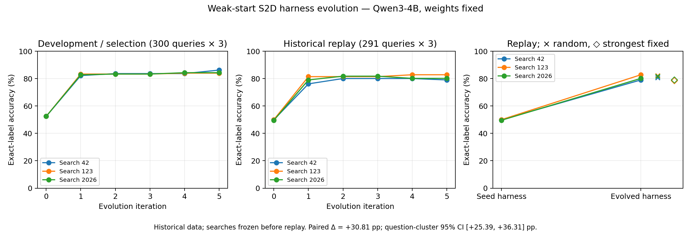

# 当前目标：从简单harness搭建RSI基础设施

本阶段提供可复用的Meta/Task闭环。默认使用自然、未经优化的起点；强固定和随机搜索属于研究参考，超过它们不作为基础设施验收条件。

默认`configs/memory_s2d_agent.json`指定`initial_baseline="no_memory"`：普通分类提示、合法标签与输出合同、无检索示例、单次调用。评分、模型和数据角色保持固定，Meta可逐步添加检索、上下文组织与执行流程。参考策略即使分数更高，也不会替换明确指定的初始父代。

先按[环境指南](getting-started.md)安装并启动Task服务，然后运行一个seed：

```sh
sh scripts/harness.sh run search --seed 42 --output runs/my-agent-demo
sh scripts/harness.sh inspect runs/my-agent-demo
```

`inspect`支持单run和suite；完整曲线与策略保存在`runs/my-agent-demo/frozen.json`，逐轮记录在`evolution/`。本命令不打开测试集。默认仍会计算六个固定参考和随机对照，账本记录其成本；这些参考不决定初始父代，不用于判断基础设施是否可用。

验收关注：

1. 真实Meta/Task能够执行，候选通过校验后被评估。
2. 评分、接受/拒绝和下一轮父代更新可追溯。
3. 配置、代码、实际输入/输出、成本和失败被保留。
4. 恢复不重复已完成调用，输入变化会被拒绝。
5. 用简单起点演示相对自身的增长，完整保留持平与退化结果。

候选仍按现有重复评估规则接受，不为制造曲线更改评分。三seed与置信区间用于后续研究分析；报告中的`experiment_completed`与`research_diagnostics`分别表达执行完成和统计比较，统计比较未通过不代表基础设施执行失败。

如需重复研究比较，运行`suite`再`finalize`；同一run必须保持配置/源码一致。旧291题继续标记历史回放。

```sh
sh scripts/harness.sh run suite --output runs/my-agent-suite
sh scripts/harness.sh run finalize --output runs/my-agent-suite
```

此前强起点配置保留为`configs/memory_s2d_agent_strong.json`，使用新输出目录显式运行即可。旧实验的精确复核需检出匹配的源码提交，详见[历史强起点报告](harness-agent-v1.md)。弱起点已完成真实实测，结果与证据见下文；旧强起点曲线保持原样。

## 已完成的弱起点真实实测

本轮已实际运行DeepSeek Meta + 本地Qwen3-4B Task，三个seed各五轮，权重保持不变。开发平均 **52.44%→84.85%**；旧291题历史回放平均 **49.87%→80.68%**，三次均相对初始harness提高。

| seed | 开发集起点→最终（300题×3） | 历史回放起点→最终（291题×3） | 接受改进的轮次 |
| --- | ---: | ---: | --- |
| 42 | 52.44%→86.22% | 49.94%→79.04% | 1,2,5 |
| 123 | 52.44%→84.00% | 50.06%→82.82% | 1,4 |
| 2026 | 52.44%→84.33% | 49.60%→80.18% | 1,2,4 |



历史回放相对起点平均增加30.81个百分点，按题平均repeat/seed后bootstrap的95%区间[25.39,36.31]个百分点。这是已使用过数据的回放，描述本框架实例的效果；不作为新的独立确认或通用算法结论。

最终三个策略仍是单次Task调用：seed42/123使用Meta生成的Python检索函数，分别提供8/12个示例；seed2026使用BM25和12个类别多样化示例。Task模型与评分没有改变，模型输入上下文增加了训练记忆。原始2700条起点评估记录均已核验：每条只有一次模型调用，检索记忆ID为空。

曲线记录每轮被保留的父代。主要增长发生在第一轮，后续还有小幅提升；持平、退化和失败候选都在记录中。历史回放分数可在开发分数上升时下降，最终策略始终按开发选择冻结，不按回放结果回选。

### 实际异常与恢复

- seed42第3、4轮Meta输出超过8192-token上限，两轮均记录失败、保留父代并继续；第5轮成功接受了改进。失败消耗原轮次/调用预算。
- 总计15次Meta CLI调用，13次正常完成、2次输出超限；49次有效小批试跑，26个候选进入完整开发验证。所有已开始的应用调用都有结束记录。
- 失败调用缺少配置确认元数据，审计使用`null`和缺失计数表达；不会把缺失字段误报成配置发生修改。
- 实跑还发现CLI帮助输出会隐藏受支持参数，导致doctor误报。现仅对已经真实验证的固定2.1.169版本采用已知参数合同；未知版本仍检查并拒绝缺失参数。实际就绪检查及两项兼容性回归测试通过。
- 冻结后重复原suite命令，Task/Meta新增调用均为0。74项离线检查通过；临时服务停止，GPU显存释放。

### 成本与可追溯结果

| seed | 正式搜索Task生成请求（含参考） | 历史回放Task生成请求 | Meta CLI内部轮次 | Meta失败调用 |
| --- | ---: | ---: | ---: | ---: |
| 42 | 26371 | 5238 | 104 | 2 |
| 123 | 28331 | 5238 | 104 | 0 |
| 2026 | 26391 | 4365 | 131 | 0 |

合计81,093次搜索阶段Task请求、14,841次回放Task请求，共95,934次本地Task生成请求；15次Meta CLI调用含339个内部轮次。缓存命中不计为新请求。CLI轮次/估计费用不是已核验的供应商HTTP请求数或账单，CPU统计范围见审计字段。

本阶段验收依据是实际闭环、简单起点增长、记录与恢复。参考结果同时保留：强固定78.77%、随机81.56%、演化80.68%（均为历史回放均值）；它们不改变起点或基础设施验收结论，不据此声称优化算法更先进。

[聚合报告与冻结策略](validation/memory-agent-weak-v1.json) · [真实起点/工具/成本审计](validation/memory-agent-weak-audit.json) · [运行、就绪和恢复证据](validation/memory-agent-weak-runtime.json) · [缩放坐标图](validation/memory-agent-weak-v1-zoom.png)。原始逐题输入/输出、工具调用与密钥保存在Git忽略目录。

本轮演化核心与配置使用提交`29d5e4d`；报告记录的源码、工具脚本和模型文件哈希可交叉验证。报告/就绪辅助脚本的修正未改变生成这些曲线的演化核心字节。正式命令：

```sh
sh scripts/harness.sh run suite --parallel --config configs/memory_s2d_agent.json \
  --data data/memory-s2d-expanded \
  --task-base-urls http://127.0.0.1:18000/v1 http://127.0.0.1:18001/v1 http://127.0.0.1:18002/v1 \
  --output runs/memory-s2d-agent-weak-v1
sh scripts/harness.sh run finalize --parallel --config configs/memory_s2d_agent.json \
  --data data/memory-s2d-expanded --output runs/memory-s2d-agent-weak-v1
sh scripts/harness.sh report --suite runs/memory-s2d-agent-weak-v1 \
  --runtime runs/memory-s2d-agent-weak-v1/task-runtime.json --name memory-agent-weak-v1 \
  --output-dir runs/memory-s2d-agent-weak-v1/public
```

先启动对应端口的三个Task服务；单卡可映射三个seed到同一服务并去掉`--parallel`。原run恢复必须使用完全匹配的源码/配置；复核旧源码可检出报告中的实现提交，导出弱起点命名需使用匹配的报告工具版本。
