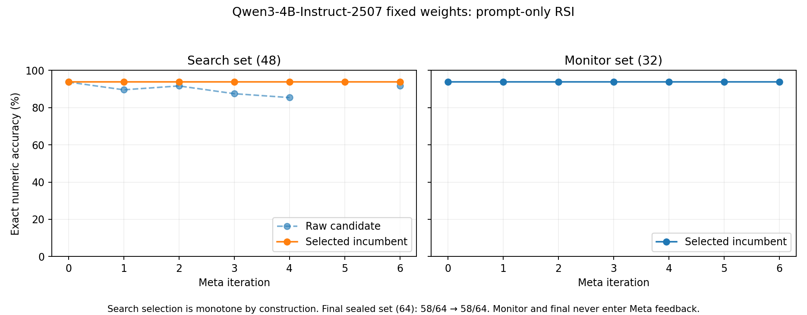
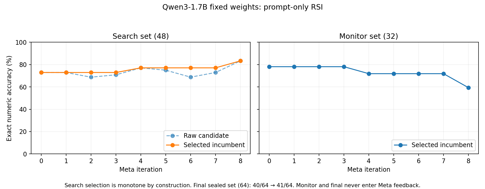

# 增长实验：诊断、协议与记录

## 为什么之前没有超过父代

原始 DeepSeek pilot 只有 6 个开发题，父代与三个候选全部 6/6。严格提高才接受的规则下，满分父代没有增长空间；增加轮数不能解决这个天花板。三次提案确实改变了 prompt，Task 没有空响应或截断，选择器的行为符合规则。

进一步实验发现另外三个问题：

1. **反馈不足。** 原来只给 Meta 前八条记录，没有优先给错题、开发参考答案和已拒绝候选的具体表现。现已补齐。长轨迹同时保留开头和末尾，避免截掉真正的最终错误。
2. **评测适配不足。** 最初将 MATH 数值题接入时仍沿用严格的 GSM8K-style 解析，许多 boxed 答案被记为格式错误。已增加固定 `math_numeric` 评分；这是协议修正，不计为 RSI 提升。旧运行完整保留。
3. **提示修改引入回归。** 4B 第二轮修好了原先的 3 道错题，却又做错原来正确的 4 道题。当前的整体替换式长检查清单并不稳定。新策略要求从父代做简短、局部的修改，保留成功行为。

因此“没超过父代”包含任务选型、评测适配和提案策略三个层面；已验证的选择/回退逻辑没有把更高开发分的候选误拒绝。

## 数据与不可变规则

数据来自 [MATH-500](https://huggingface.co/datasets/HuggingFaceH4/MATH-500)，固定 revision `6e4ed1a2a79af7d8630a6b768ec859cb5af4d3be`。选择 level ≥ 3、无 Asymptote 图、答案为整数/小数/整数分数的题，共 255 道。种子 42 后预先划分 calibration 16、dev 48、monitor 32、final 64；其余 95 道不用。ID、校验和与等级分布进入 manifest。

这是 **MATH-500 数值子集的重新划分实验**，不等同于标准 MATH-500 成绩，也不表示这些题未被模型预训练使用。

- calibration 只检查难度、协议和截断，不供 Meta 搜索。
- Meta 只看 dev 的轨迹与参考答案。每轮一个候选，严格提高 dev accuracy 才接受。
- 搜索结束后，对每个不同的已选中版本补评 monitor；未变化的版本复用结果。原始候选的 dev 分数和全部拒绝记录保留。
- 最后按 dev 冻结选择，在 final 上评估 baseline 与选中版本。相同 prompt 直接复用同一份结果。
- 所有轮次的模型、数据、评分器、temperature=0、8192 输出 token 上限和并发 16 均固定。模型权重不更新。
- dev 选中曲线单调上升是选择规则的结果；是否泛化需要看 monitor 和 final。final 报告逐题得失及配对 bootstrap 区间，不能只看最优开发分。

`math_numeric` 接受最后一个完整 boxed 数值、显式 `####` 数值或纯数字。整数分数用 Fraction 精确比较；不执行表达式，不从普通推导中猜答案。若 boxed 与 `####` 给出不同有效数值，则记为答案冲突。原 GSM 风格格式的遵守率另以 `strict_format_compliant` 统计，该字段不表示当前 boxed 合同的服从率。该评分器仅覆盖本实验的有理数子集，不实现通用符号等价评分。

## 校准记录

全部八次校准及原回答重评分诊断见 [calibrations.json](validation/calibrations.json)。这些调整均不计为 RSI 增长。

| 模型 / 协议 | 原始正确数 | 格式错误 | 截断 |
| --- | ---: | ---: | ---: |
| Qwen3-4B，4096 token，严格格式 | 11/16 | 4 | 4 |
| Qwen3-4B，8192 token，严格格式 | 14/16 | 1 | 1 |
| Qwen2.5-1.5B，原 system 提示 | 0/16 | 15 | 0 |
| Qwen2.5-1.5B，system 中加格式例子 | 0/16 | 15 | 0 |
| Qwen2.5-1.5B，合并用户消息的固定模板 | 4/16 | 9 | 0 |
| Qwen3-1.7B，严格格式 | 3/16 | 11 | 0 |
| Qwen3-1.7B，MATH 数值评分，重新运行 | 6/16 | 1 | 1 |
| Qwen3-1.7B，固定 boxed 合同，重新运行 | 8/16 | 1 | 1 |

1.5B 的无关指令探针对比中，Transformers 原生与 vLLM 结果相同，输入 token 也相同；并未发现服务端丢失 system 消息。该模型在这些探针上较弱地服从 system 指令。加格式例子、用户消息模板均保留为校准失败记录，没有拿 0/16 做增长基线。

任务模型固定快照：

- [Qwen3-4B-Instruct-2507](https://huggingface.co/Qwen/Qwen3-4B-Instruct-2507)：`cdbee75f17c01a7cc42f958dc650907174af0554`。
- [Qwen2.5-1.5B-Instruct](https://huggingface.co/Qwen/Qwen2.5-1.5B-Instruct)：`989aa7980e4cf806f80c7fef2b1adb7bc71aa306`。
- [Qwen3-1.7B](https://huggingface.co/Qwen/Qwen3-1.7B)：`70d244cc86ccca08cf5af4e1e306ecf908b1ad5e`；固定 `enable_thinking=False`，不在搜索时切换模式。

Meta 均为 Claude Code 2.1.169 + DeepSeek API，状态和提供商参数限于项目与子进程。本机为 4 × A100-SXM4-80GB，单个 Task 服务只需一张卡；没有做训练。

## 4B 六轮：无增长的完整对照

实现快照：[053aa21](https://github.com/PLUTO-SCY/RSI_Base/commit/053aa21711978e16855619d66f39ce5213589897)。此轮使用严格数值格式评分，不能与后来的 MATH 评分直接比较。

| 轮数 | 原始候选 dev | 相对父代修复 / 退步 | 选择 |
| --- | ---: | ---: | --- |
| 0 | 45/48 | — | baseline |
| 1 | 43/48 | +1 / −3 | 保留父代 |
| 2 | 44/48 | +3 / −4 | 保留父代 |
| 3 | 42/48 | +1 / −4 | 保留父代 |
| 4 | 41/48 | +2 / −6 | 保留父代 |
| 5 | 无有效 JSON | — | 拒绝非法提案 |
| 6 | 44/48 | +2 / −3 | 保留父代 |

选中版本始终为父代：monitor 30/32，final 58/64，增长为 0。最终相同 prompt 复用同一份 final 结果；没有凭第二次抽样制造收益。搜索调用 320 次 Task、6 次 Meta；补评调用 96 次 Task。



机器记录：[growth.json](validation/growth.json)。原始产物位于 `runs/qwen-math-growth-8k/`，仍保留全部候选、回复与决策。

## 1.7B 六轮对照：评分修正仍不足以产生增长

实现快照：[8dbed75](https://github.com/PLUTO-SCY/RSI_Base/commit/8dbed754dc90511ae3a84540fd752de7e6d099d9)。使用 MATH 数值评分，但求解策略和格式说明仍在同一个可变 prompt 中。

baseline dev 33/48，六个候选依次为 23、30、29、31、32、31/48，全部保留父代。独立曲线中的 monitor 为 20/32，final 为 42/64；未出现增长。第一轮未解析答案从父代的 3 个增至 17 个，说明修改策略会破坏输出约定。

记录：[growth-v2.json](validation/growth-v2.json)、[曲线](validation/growth-v2.png)。搜索 368 次 Task、6 次 Meta；补评 96 次 Task。

## 固定输出合同后的八轮实验

实现快照：[70e11a6](https://github.com/PLUTO-SCY/RSI_Base/commit/70e11a6059df541e50fb53c65f828554d63d42d3)。固定 Task 用户后缀要求 boxed 数值答案；Meta 只修改求解策略，宿主强制候选不超过 600 字符。搜索前固定八轮，不根据观察集或最终分数追加轮次。

校准 8/16、未解析 1 个、截断 1 个。正式结果：

| 阶段 | 原始候选 dev | 已选中 dev | 独立曲线 monitor |
| --- | ---: | ---: | ---: |
| baseline | 35/48 | 35/48 | 25/32 |
| 第1轮 | 35/48 | 35/48 | 25/32 |
| 第2轮 | 33/48 | 35/48 | 25/32 |
| 第3轮 | 34/48 | 35/48 | 25/32 |
| 第4轮 | 37/48 | 37/48 | 23/32 |
| 第5轮 | 36/48 | 37/48 | 23/32 |
| 第6轮 | 33/48 | 37/48 | 23/32 |
| 第7轮 | 35/48 | 37/48 | 23/32 |
| 第8轮 | 40/48 | 40/48 | 19/32 |



最终验收 baseline **40/64 → 41/64**：修复 5 题、退步 4 题。其中修复包含 4 道原先数值错误的题与 1 道原先无法解析的题。净增 1.56 个百分点，配对 bootstrap 95% 区间为 **−7.81 至 +10.94 个百分点**，跨过 0。

冻结策略后预先安排的两次 dev 复测：

| 复测 | baseline | 选中版本 | 净增 |
| --- | ---: | ---: | ---: |
| 第1次 | 37/48 | 38/48 | +1题 |
| 第2次 | 34/48 | 37/48 | +3题 |

两次复测均为正，平均净增 2/48（4.17 个百分点），小于原搜索记录的 +5/48。它们检查的是相同 dev 题上的重复性，不是独立泛化测试。

主循环冻结后的首次 monitor 评估是 21/32；随后统一重放各选中版本得到图中的 19/32。两次均保留在机器记录中。这种差异以及 dev 复测波动说明，temperature=0 也没有使本次服务执行完全一致；不能把单次得分差都归于策略收益。

**结论：出现了开发集上升及同题复测的正向变化，独立泛化收益仍未确认。** 观察集退步、最终验收仅净增 1 题，存在适应开发集和评测噪声的迹象。权重没有训练；各次模型/协议校准的起点变化均未算成 RSI 增益。

正式搜索、独立曲线/验收和两次复测分别消耗 464、224、192 次 Task 调用，共 880 次；Meta 共 8 次 CLI 提案调用。当前协议校准另有 16 次 Task 调用。各阶段账本独立，Meta CLI 调用数不等同于其内部 HTTP 请求数或服务商账单。

已完成运行的真实恢复检查通过：汇总完全相同，新增调用 0。公开的 [growth-small.json](validation/growth-small.json) 包含源码提交映射、模型文件/依赖指纹、全部有效候选策略、逐题得失汇总和复测。全部八次校准见 [calibrations.json](validation/calibrations.json)。

这些划分用于探索性的框架诊断，并在多个协议中复用；确认性研究需要另行锁定未使用的测试集。候选选择阶段不读 monitor/final，所有曲线补评和复测均不再改变最终策略。下一轮任务与设置应按[文献 benchmark 核查](research/harness-benchmark-setups.md)对齐。

## 复现当前协议

```sh
sh scripts/setup.sh
sh scripts/setup_task.sh
.venv-task/bin/python scripts/download_task.py \
  --model Qwen/Qwen3-1.7B \
  --revision 70d244cc86ccca08cf5af4e1e306ecf908b1ad5e \
  --directory .local/models/qwen3-1.7b
.venv/bin/python scripts/prepare_growth_data.py
RSI_GPU=2 RSI_TASK_PORT=18002 \
  RSI_TASK_MODEL_DIR=.local/models/qwen3-1.7b RSI_TASK_MODEL_NAME=Qwen/Qwen3-1.7B \
  sh scripts/serve_task.sh --trust-request-chat-template
```

保持本机 loopback 服务运行，另一个终端执行：

```sh
RSI_LOCAL_API_KEY=EMPTY .venv/bin/python scripts/run_growth.py calibrate \
  --config configs/qwen_1_7b_boxed_growth.json --output runs/qwen-1_7b-boxed-v3
RSI_LOCAL_API_KEY=EMPTY .venv/bin/python scripts/run_growth.py search \
  --config configs/qwen_1_7b_boxed_growth.json --output runs/qwen-1_7b-boxed-v3
RSI_LOCAL_API_KEY=EMPTY .venv/bin/python scripts/run_growth.py audit \
  --config configs/qwen_1_7b_boxed_growth.json --output runs/qwen-1_7b-boxed-v3
.venv/bin/python scripts/recheck_growth.py --run runs/qwen-1_7b-boxed-v3
.venv/bin/python scripts/inspect_run.py runs/qwen-1_7b-boxed-v3
```

`EMPTY` 只用于无鉴权的本机 endpoint。DeepSeek 继续使用 `.env.local`。依赖与模型放在 `.venv-task`、`.local`；不会修改系统 Python 或全局 Claude/shell 配置。环境脚本、两份依赖锁和模型指纹脚本均随仓库保存。

数据准备脚本拒绝覆盖已有划分。恢复要求输入、源代码和依赖锁一致；历史协议应检出对应提交后运行。完整数据、权重、凭据与逐题轨迹不进 Git，曲线、汇总、配置和复现代码进入 Git。
