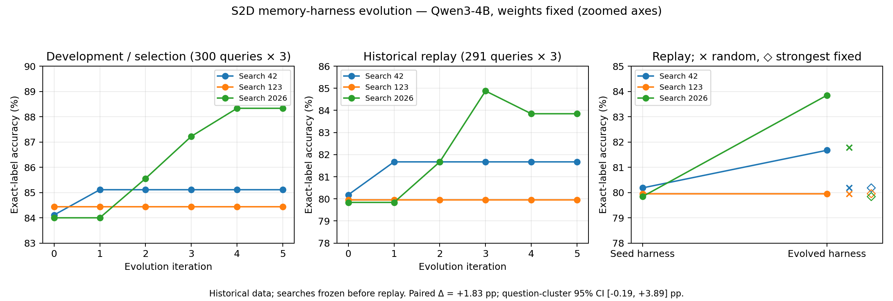

# 可读源码、可调试候选的 harness 演化

本文保存强起点历史试验。当前基础设施默认改用简单起点，见[当前目标与运行方式](backbone-demo.md)。研究比较中的“稳定性未达标”不作为框架可用性的验收结论。

本版针对[旧搜索诊断](harness-search-diagnosis.md)修复优化端。Task仍为固定权重Qwen3-4B-Instruct-2507，不训练LoRA。接上工具不等于证明收益，实验结论单独报告。

## Meta的能力与边界

Claude Code由项目局部DeepSeek API配置驱动，新增五个宿主MCP工具：

| 工具 | 能力 |
| --- | --- |
| `list_artifacts` | 列出完整源码、训练记忆、开发题、失败编号、历史候选和固定对照 |
| `read_artifact` | 分页读取已登记的完整文件 |
| `get_case` | 指定开发题的gold、实际模型输入、检索ID及各步输出，支持父代和历史候选 |
| `evaluate_candidate` | 试跑配置或Python检索代码，返回逐题得失与完整轨迹 |
| `submit_candidates` | 提交最多两个本轮已试跑的候选，由宿主完整验证 |

每轮四次有效试跑，错误修正/重复候选最多八次尝试；40次工具调用、CLI内部最多40轮、600秒超时。固定24题分层试跑批次由seed和轮次确定，Meta与随机搜索使用相同批次。候选接受仍需300题×3次验证，各次均不退步且平均净增至少一题。

**协议变化：Meta现在能够看到全部300题开发集的题目、gold与轨迹。** 这300题同时用于优化和选择，不能再当作优化过程未见的验证集。最终291题、答案、密钥和宿主个人目录不在工具可读范围内。

除已有配置外，候选可设置`retrieval="python"`与`retrieval_code`：

```python
def rank(query, memory):
    # memory仅包含训练行的id/question/answer
    return [row["id"] for row in memory]
```

也可返回带有限`score`的ID字典列表。宿主核验ID只能来自允许的训练记忆且不得重复，再统一应用示例数量、布局、输出合同和评分。禁止嵌入开发题、ID或逐题答案表。代码编辑范围目前是检索/重排函数，尚未开放任意修改执行器、评分器或工作流源码。

代码在无网络、无宿主home、无密钥和GPU的独立Linux namespace内运行，仅提供Python标准库；单批512MiB内存、30秒CPU、45秒宿主超时。主检索index的完成批次记录CPU/墙钟与内存峰值；该统计仅覆盖当前进程，不含失败/中断批次及临时confirm/challenge子index，不能当作完整机器级成本。

## 去重、对照与证据

- 规范化对比布局7/8例等无效字段组合；单步候选比较全部开发请求，输入完全相同就跳过Task调用。
- 跨候选按实际模型请求复用结果；不同repeat分别保存。两步流程按实际逐步请求缓存，不把首步相同误判成整条工作流相同。
- 完整源码、实际输入、父子得失和失败子代轨迹均可回查。
- 从十个固定对照中开发分数最高者起跑，包含旧随机搜索得到的三个强配置；该历史试验用于检验强方案上的额外收益。
- 随机搜索有相同轮数、试跑数和完整验证数上限，并包含通用Python检索模板。但随机模板空间小于Meta任意编写检索代码的空间，实际调用/token成本也不同，不能称严格等算力或全空间均匀随机。
- 保存工具调用、候选代码、逐题轨迹、决策、物理API调用账本与源码/数据/依赖哈希。评估summary中的`model_calls`为逻辑工作流调用数；实际新增请求以`calls.jsonl`为准。

## 安装与复现

完整环境说明见[上手指南](getting-started.md)。本模式另需支持非特权user namespace的Linux。x86_64脚本通过固定URL和SHA256提取bubblewrap到项目`.local/`，需要系统已有`dpkg-deb`；不安装系统包、不启动Docker daemon。

```sh
sh scripts/harness.sh setup --gpu --claude --sandbox
sh scripts/harness.sh credentials
sh scripts/harness.sh data
sh scripts/harness.sh model
# 另开终端启动服务
RSI_GPU=0 RSI_TASK_PORT=18000 sh scripts/harness.sh serve
# 服务就绪后
sh scripts/harness.sh doctor --ready --config configs/memory_s2d_agent_strong.json
sh scripts/harness.sh run suite --config configs/memory_s2d_agent_strong.json \
  --task-base-urls http://127.0.0.1:18000/v1 http://127.0.0.1:18000/v1 http://127.0.0.1:18000/v1 \
  --output runs/my-agent-suite
sh scripts/harness.sh run finalize --config configs/memory_s2d_agent_strong.json \
  --output runs/my-agent-suite
```

三卡并行时另启动GPU1/18001与GPU2/18002，suite增加`--parallel`并替换对应端口，finalize也增加`--parallel`。全部搜索冻结后才回放测试。改代码/配置要使用新run；恢复需要完全相同的源文件和协议。旧协议仍可复现，省略`--config`时入口现在默认运行弱起点工具化配置；本页强起点参考须显式指定`configs/memory_s2d_agent_strong.json`。

冻结回放结束后，记录服务指纹并导出曲线/成本；环境与代码应先提交，导出器会校验运行源码与Git字节一致：

```sh
sh scripts/harness.sh runtime --gpu 0 --port 18000 --output runs/my-agent-suite/task-runtime.json
sh scripts/harness.sh report --suite runs/my-agent-suite \
  --runtime runs/my-agent-suite/task-runtime.json --name memory-agent-v1 \
  --output-dir runs/my-agent-suite/public
.venv/bin/python scripts/audit_memory_agent.py --suite runs/my-agent-suite \
  --output runs/my-agent-suite/public/search-audit.json
```

曲线同时保留0–100%全尺度版本和标明缩放坐标的`-zoom`版本，方便检查强起点附近的变化。

## 本次实验状态

72项离线测试通过；本机namespace隔离、候选返回值、跨候选缓存、repeat隔离和冻结恢复均有覆盖。真实DeepSeek/Claude Code预检完成18个内部轮次、17次宿主工具调用、两次Python检索试跑及提交；宿主232次Task请求、1次Meta CLI调用，未打开测试。8题的小预检未产生增长，仅用于验证闭环，不作为性能证据。首次预检因CLI轮次限制未完成提交，记录保留，随后增加限制并修正阅读/试跑顺序。

## 历史研究结果：有增长，研究统计门槛未通过

三次搜索均从十个固定对照中的最强者出发；Task权重、评分、数据、上下文和生成预算固定。开发平均84.19%→85.96%，两次增长、一次停滞。

| seed | 开发起点→最终 | 历史回放：强固定→演化 | 历史回放：随机 |
| --- | ---: | ---: | ---: |
| 42 | 84.11%→85.11% | 80.18%→81.67% | 80.18% |
| 123 | 84.44%→84.44% | 79.95%→79.95% | 79.95% |
| 2026 | 84.00%→88.33% | 79.84%→83.85% | 81.79% |

平均历史回放：强固定79.99%，随机80.64%，Meta演化81.83%。相对强固定Δ=+1.83pp，95%区间[-0.19,+3.89]；相对随机Δ=+1.18pp，区间[-0.61,+3.02]。区间按题平均repeat/seed后bootstrap，条件于固定模型和数据，不提供跨任务或搜索算法的普遍保证。

**研究统计门槛未通过**：seed123无增长，两项比较区间均跨0。这291题已使用过，只能历史回放，不能称全新独立确认。



[全尺度曲线](validation/memory-agent-v1.png)与缩放图使用相同数据。seed2026在第2/3/4轮连续提高开发分数；其第3轮回放84.88%，第4轮最终回放83.85%，出现开发上涨、回放下降的情况。保留按开发选择的最终策略，不用回放分数回选第3轮。

## 已验证的机制与剩余问题

- seed42首轮被接受的策略只替换了检索代码：词汇归一化、词/字符相似度、基于训练记忆的类别中心组合，其他策略字段保持父代。
- seed2026依次接受了判别提示改写、检索与提示的组合改写，并进一步提高。组合修改尚未做逐项消融，不能将全部收益归因于某一组件。
- seed123补全了20次有效试跑对应17个不同配置的全量开发评估，含10次未正式提交的试跑。全部未通过接受条件，最高为253/252/252，低于起点253/254/253；本次停滞不能仅归因于24题预筛。附加诊断不改变正式曲线或冻结策略。
- 源码/反馈和调试通路已通过真实运行验证；仍需改善候选生成质量与选择的泛化稳定性。LoRA继续后置。

## 实际成本与复现证据

| seed | 正式搜索Task请求 | Meta CLI内部轮次 | 额外开发诊断Task | 历史回放Task |
| --- | ---: | ---: | ---: | ---: |
| 42 | 34740 | 118 | 0 | 3492 |
| 123 | 32894 | 127 | 5300 | 2619 |
| 2026 | 32795 | 130 | 0 | 6111 |

正式搜索共100,429次Task请求、15次Meta CLI调用（内部375轮）；附加开发诊断5,300次Task，历史回放12,222次Task，预检另计。Task SDK禁用自动重试；Meta CLI可能内部重试，CLI轮数不等于已核验的供应商HTTP请求/账单。随机与Meta的候选数上限相同，实际成本和代码生成空间不同。CPU统计范围见前文，不能当作全部计算成本。

15次正式Meta调用均正常返回，配置指纹均未变化；所有应用调用都有完成记录。冻结后原命令恢复，Task/Meta新增调用均为0。三张服务的模型文件指纹一致，第四张卡未占用。

[聚合结果与源码/权重指纹](validation/memory-agent-v1.json) · [工具可见性与成本审计](validation/memory-agent-search-audit.json) · [停滞seed附加检查](validation/memory-agent-probe-selection.json) · [安装/预检证据](validation/memory-agent-setup.json)。原始题目、模型输入/输出和密钥保留在忽略目录。

本机已封存运行当时使用`--parallel`、`--config configs/memory_s2d_agent.json`、`--data data/memory-s2d-expanded`和`--output runs/memory-s2d-agent-v1`，端口依次18000/18001/18002。实现起点为`cc87afd`；导出报告的源码/tooling提交与文件哈希见JSON。后续文档/审计提交未改变实验核心字节。

附加筛选诊断命令（全部正式搜索冻结后运行，不改正式选择）：

```sh
.venv/bin/python scripts/audit_probe_selection.py --suite runs/memory-s2d-agent-v1 \
  --data data/memory-s2d-expanded --seed 123
```

精确复核本页已封存实验时，检出`61a8eb3`并使用当时的`configs/memory_s2d_agent.json`及匹配的原始run。当前同名配置已改为弱起点，不可用于恢复旧强起点run；当前强起点配置用于新参考运行。
