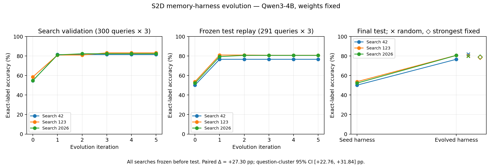

# 基础 backbone 与强基线挑战分开验收

**当前判断：软件backbone已经可复用，方法性能还需要改进。** 演化后79.34%明显超过简单few-shot的52.04%，但没有统计证据优于强固定对照78.81%或随机搜索80.72%。因此“标准起点门槛通过”只表示超过简单起点，不表示当前Meta演化方法已经优于强方法，也不表示实现了持续递归增长。

本轮仍只做固定权重的harness evolution，LoRA后置。两种问题分别报告，不能互相替代：

1. **基础backbone：** 从标准简单harness出发，Meta能否自动选择/改进记忆检索，获得可重复的独立测试收益。
2. **强基线挑战：** 在最强固定harness基础上，能否继续取得独立测试增益。

此前强起点实验完整保留：50题选择集上的提升没有通过211题测试；扩大到300选择/291新测试后的强起点实验也已完成，仍未通过门槛。结果分别报告，不用简单起点的收益覆盖。

## 标准起点实验

固定few-shot 8作为初始Task harness，训练记忆200条。few-shot 8是[Meta-Harness分类实验](https://arxiv.org/html/2603.28052v1)列出的固定基线；它在本任务中明显弱于已知的检索harness，因此超过它的幅度不能代表Meta搜索相对强方法的优势。所有候选仍可使用同一200条训练记忆，比较按问题检索与固定示例选择。

演示配置 `configs/memory_s2d_starter.json` 显式设置`initial_baseline=fixed_fewshot`，也是记忆CLI的默认示例。配置不指定该字段时，框架仍从最强固定基线出发。Meta只看到该起点及自身候选的验证汇总，不获得其他固定控制策略的成绩。

数据角色分别为：200条带标签训练记忆供检索；300道选择题用于评估并选择候选harness；291道最终测试题只在全部策略冻结后评估。历史50选择/211测试实验已经失败，不与当前300选择/291测试的成绩混为同一实验。

Task仍是同一4B模型；单题最多两次调用、每次128输出token、上下文12000字符。3次独立搜索，5轮×2候选，每候选重复验证3次，固定300题选择/291题新测试。所有实验先冻结，随后才打开新测试；对两个优化设置同时保持这一边界。

seed控制训练记忆排列、固定few-shot内容、训练诊断与随机控制；Meta API采样不能由它严格控制。temperature0也不能保证不同服务批次位级一致，因此测试对照在各suite内重复测量并配对比较，不跨suite挑选较低基线。

基础门槛：每次搜索均超过各自固定few-shot起点，且按题聚类的配对95%区间下界大于0。同时报告最强固定harness与选中harness的差距；基础门槛通过不表示优于强固定策略，也不表示发明了BM25或自由代码演化。

## 2026-11-17 独立测试结果

三次搜索及随机控制全部冻结后，对同一291道新测试题各重复3次。表中为重复平均准确率；三次重复不视作873道独立题。

| 搜索seed | 固定few-shot起点 | 演化后 | 随机搜索 | 七个固定对照中验证最优者 |
| --- | ---: | ---: | ---: | ---: |
| 42 | 50.17% | 76.63% | 81.90% | 78.92% |
| 123 | 53.72% | 80.76% | 80.41% | 78.47% |
| 2026 | 52.23% | 80.64% | 79.84% | 79.04% |
| 平均 | **52.04%** | **79.34%** | **80.72%** | **78.81%** |

相对标准起点平均 **+27.30个百分点**，按题聚类的配对95%区间 **[+22.76,+31.84]个百分点**，三次搜索均为正，基础门槛通过。本实验支持从简单few-shot出发搜索检索与上下文配置能带来可重复收益；这一结论只针对简单起点。

但更强的结论没有通过：相对强固定对照平均+0.53个百分点、95%区间[−2.37,+3.44]；相对随机搜索平均−1.37个百分点、95%区间[−3.70,+0.92]。这两项为冻结后的描述性对照，不替换预定门槛。没有证据证明Meta引导优于随机搜索，也没有证明持续超过强固定harness。另行从强固定父代开始的[强起点实验](memory-evolution-expanded.md)同样失败，不能被本表覆盖。

主要增长发生在第一轮从固定示例转向问题相关检索。seed2026第二轮还有小幅增长；seed123第三轮选择分上升而测试略降，随后保持平台。不能把选择集单调性写成逐轮泛化增长。

最终三种策略均只需一次模型调用，但实际输入token约为起点的2.41倍；随机控制有两次选中了双调用策略。匹配的是候选数、重复次数和单题上限，实际调用、token和耗时另报，不能据此声称严格等成本优势。模型权重、标签合同与评分始终固定。

预先安排的冻结消融也已完成：

| 搜索seed | 仅采用演化结构，保留原prompt | 仅采用演化prompt，保留原结构 | 完整演化策略 |
| --- | ---: | ---: | ---: |
| 42 | 74.46% | 51.20% | 76.63% |
| 123 | 81.44% | 49.37% | 80.76% |
| 2026 | 78.69% | 60.14% | 80.64% |

有序记忆在三次搜索的全部测试题上均发生变化。消融支持收益主要来自检索/上下文结构；prompt效果不一致。两部分可能有交互，不能相加归因。消融不参与选择。两套完整实验的真实恢复检查均保持冻结选择、新增Task/Meta调用0。

机器可读报告：[memory-evolution.json](validation/memory-evolution.json)。曲线中的测试轨迹是全部策略冻结后的统一回放，不参与选择：

主比较以每条记录的`baseline_name`和对应policy为准，本实验为`fixed_fewshot`。导出字段`comparison_definition`说明封存协议中沿用的早期强基线描述；原始协议未回写改动。

适用范围限于这一公开合成分类任务和固定4B模型，不等于跨任务/模型泛化或论文主表复现。291题已用于本次验收，不能据其成绩继续调参后再称为新测试。后续仍优先完善harness搜索与选择，不自动启动LoRA。

## 共享控制测量

为避免重复执行已完成的固定对照，标准起点实验复用强起点实验的固定控制测量。导入脚本检查模型/生成设置、数据、依赖锁、策略/评分实现和评估函数AST一致，并校验原始checkpoint哈希。只复用控制测量，不导入候选或测试结果。复用的观测不是新的独立样本；物理调用成本在来源账本中保留。

## 环境与复用入口

环境安装、数据/模型下载、单卡与三卡运行、恢复及导出统一见[从全新clone开始的上手指南](getting-started.md)，入口为`sh scripts/harness.sh`。该路径不依赖作者的原始run或固定控制缓存。

本报告的标准实验复用了已经校验的固定控制测量，这是历史实验成本说明，不是新用户的启动前提。仅当手头确有兼容来源run时，才需要使用`scripts/import_memory_baselines.py`；通常可直接运行suite，由运行器自行评估控制。

发布的核心源码与调度/导出脚本提交分别保存在机器可读报告中。恢复历史运行应使用其对应源码，不把新的安装或调度辅助脚本当成新的算法增益。
